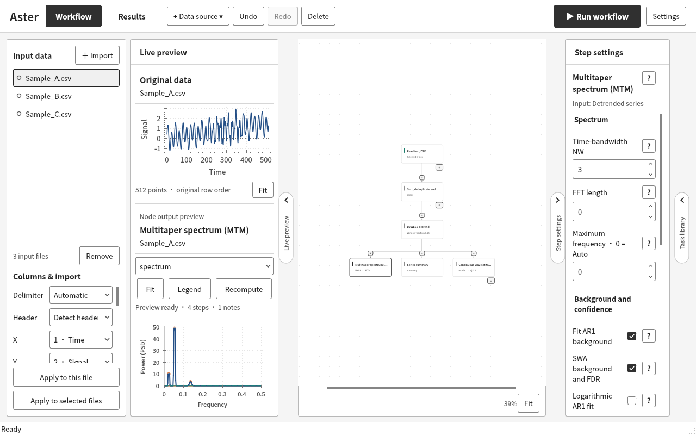
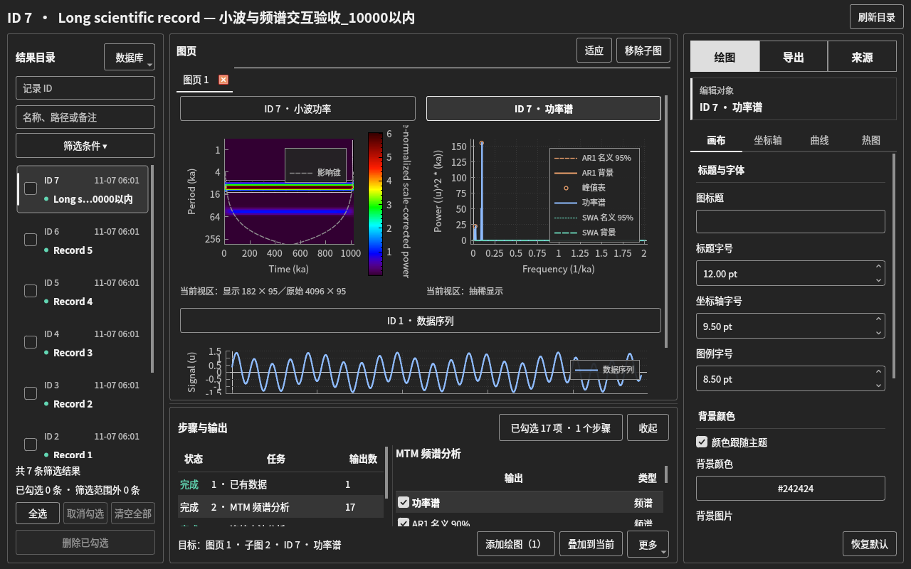

# Aster 1.2.0-alpha.20 验收记录（历史记录）

> 历史记录：以下环境、测试数量和限制对应标题所列版本。当前版本的验证状态见[验证入口](../validation_current.md)。

日期：2026-11-07。基线：1.2.0-alpha.19。状态：限定环境内通过，保留开发预览版本；原生平台验收尚未完成。

[结构化结果](../validation_results/1.2.0-alpha.20/acceptance_checks.json) · [当前验证范围](../validation_current.md) · [可复现工具](../../tools/acceptance/README.md)

## 修复与判断

| 问题 | 原因与处理 |
| --- | --- |
| 联合输入搜索数字时出现无关结果 | 原筛选文本包含随机 UUID，单个数字容易匹配隐藏身份。节点改按显示序号/名称，数据按显示名称/输出检索；无匹配时清除不可见的旧选择，禁止确认 |
| 两条 256 点正弦不能计算 | A 振幅 3、周期 8，B 振幅 2、周期 4 可以配对。每段 256、重叠 128 只产生 1 个完整分段；程序要求至少 2 段估计相干度。保持参数规则，改为具体提示实际点数、分段数及调整方法 |
| 窄预览侧栏难以选择输出 | 英文按钮挤压选择框，曾测得仅 6 像素宽；现在空间不足时分成两行，保留同一控件和选择状态 |
| 英文参数和导入选项被裁切 | 参数分组标题换行；简化导入选项标签，详细规则保留在提示中；覆盖 53 个通用参数页面和专用导入界面 |
| 多曲线图例压到坐标文字 | 为完整图例设置最小绘图空间，空间不足时沿用图页滚动。实际重绘完成后重新计算，覆盖普通图例缩小后的边界；不隐藏图例条目、不改用户字体 |

数值估计器、COCO 预算与模拟次数上限、数据库格式、绘图预设与输出组合规则、依赖打包脚本均与 alpha.19 相同。交叉谱改动位于调用前的参数组合诊断。

## 新执行的检查

| 项目 | 结果及范围 |
| --- | --- |
| 新交互验收程序 | 29 通过、0 失败、0 跳过，含初始化/清理和参数化行 |
| 受影响回归 | 交叉谱 42、绘图工作区 12、主界面 11 通过；合计 65，0 失败 |
| 中英文界面矩阵 | 结果页 8 组、工作流 8 组；深浅主题、1280×800 / 1920×1080；结果页再缩到 1024×700 |
| 参数目录 | 53 个通用页面 × 2 种语言 × 2 种侧栏宽度；参数往返与横向裁切检查 |
| 连续操作 | 3 个固定种子各 60 次，共 180 次；添加、叠加、替换、切页、删除、重建、交换、通栏、样式、缩放和尺寸改变 |
| 生命周期与异步 | 操作菜单仍打开时关闭原图页；旧对象失效后不操作新页。待完成读取与快速切页、撤销/重做组合检查；后台绘图控件释放，空闲读取计数稳定 |
| 地址/未定义行为 | 应用静态模块及验收程序重新编译为 ASan/UBSan；选定 11 项通过，包含相同 180 次混合操作；未报告检测错误 |
| 版本与帮助 | 版本一致性 2 项、帮助生成 6 项通过；54 个任务 / 233 个参数的中英文参考同步；应用版本输出为 1.2.0-alpha.20 |

普通 QtTest 统计共 94 项；sanitizer、重复运行和历史证据不叠加计数。不是重新完整执行全部 12 个测试程序的声明。初始搜索/布局失败记录与最终日志一起保留。测试工具曾修正布局事件等待、库依赖重新链接和专用文件编辑器的适用范围，修正后的最终执行结果用于以上计数。

## 数据规模、内存与结果核对

主要绘图夹具为 6×960 点序列及 1 条 4096 点序列，总输入 9856 点；小波 4096×95 矩阵是派生输出。工作流矩阵使用 3×512 点文件，短序列配对每方 256 点。未新增超过 10000 点的输入或超过 20000 次的迭代。

普通构建三组连续操作的 RSS 采样范围为 **146.0–150.8 MiB**。没有观察到持续按操作次数增长、对象数量失控或空闲重复读取。计时包含显式等待、绘制及后台读数，并与其他验证有并行重叠，只能作为该环境的操作记录，不能当作独立算法性能基准。各组原始采样和耗时见结构化结果。

LeakSanitizer 受运行环境的 ptrace 限制而关闭；系统 Qt/BLAS 等外部库未重新插桩。ASan/UBSan、RSS 和对象计数不构成“没有任何内存泄漏”的证明。

256 点双正弦通过真实参数编辑控件改为 **每段 128、重叠 64、FFT 0（自动）** 后，产生 **3 个完整分段**。撤销/重做期间最终预览仍归属于最终参数；预览与直接执行的输出数值和有效性标记逐项一致。两方横坐标的起点、间隔、长度、名称及单位仍须满足既有对齐规则。若只想生成纯正弦，还须把生成器的线性趋势斜率设为 0。

每段 256、重叠 128 时至少需要 384 点才有两段；两条信号的振幅、周期不同不会导致“无配对”。这属于分段参数限制，原先笼统报错影响了定位。

## 复用的既有证据

alpha.19 的 [完整回归记录](../validation_results/1.2.0-alpha.19/plot_layout_checks.json)有 12 个程序、2043 项通过。其 COCO 20000 次模拟、取消和预算检查以及未改变的算法证据继续保留，不为增加计数重复执行。当前修改涉及的联合输入、交叉谱参数诊断和绘图交互另做了上述回归。

较早的大规模夹具没有在此验收中重新执行；历史压力测试的规模不代表当前新增测试的输入规模。

## 视觉核验与本机验收

Qt 真实控件和事件驱动检查在 Debian 13、Qt 6.8.2、GCC 14.2、Release、offscreen 环境执行。截图复核涵盖中英文、深浅主题、三图通栏、侧栏折叠和密集图例。密集图例要求图页滚动，是保留完整条目和字体后的空间取舍。

Windows/MSVC、macOS 原生窗口、Linux 窗口管理器、多显示器和高 DPI 尚未由这些 offscreen 检查覆盖。建议本机按下面顺序确认：

1. 覆盖源码后重新运行 qmake 并重新构建；启动后核对显示版本为 1.2.0-alpha.20。不替换已有数据库。
2. 联合输入框搜索 6、5、不存在的名称，清空后搜索确切节点/文件；确认列表和确认按钮都跟随筛选。
3. 两条 256 点正弦建立 A/B 配对；默认 256/128 应出现具体分段提示，改成 128/64 应正常计算。
4. CWT / MTM 默认图、全选添加、删除后重建、跨记录叠加；检查目标标题、热图、影响锥、对数反转坐标和清晰度状态。
5. 三图通栏、同页拖动交换、边缘插入、Esc 取消、分隔比例、换页恢复；在系统 100% / 125% / 200% 缩放下核对拖放落点。
6. 中英文和深浅主题下缩窄侧栏，检查输出选择框、参数、图例滚动及 PNG/PDF/CSV 导出。

本机验收及最终程序/依赖材料核对通过后，才能据此决定是否定为 beta 或正式发布。
